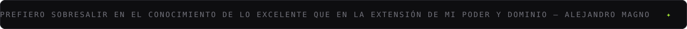

<a href="https://bastian4le.vercel.app">
  
</a>

<p align="center">
  <a href="https://bastian4le.vercel.app"></a>
  <a href="https://www.linkedin.com/in/bastian4le/"></a>
  <a href="mailto:bastian4le@gmail.com"></a>
  <a href="https://www.instagram.com/g4lapan/"></a>
</p>

### `//` Sobre mí

```ts
const galapan = {
  nombre: "Bastian A. Sánchez",
  rol: "Desarrollador web full stack",
  estudio: "Ingeniería en TI · Universidad Tecnológica de Tlaxcala",
  base: "Apizaco, Tlaxcala, MX",
  ahora: ["Aetherys", "Plataforma de la SMyT Tlaxcala"],
  enfoque: ["interfaces con movimiento", "WebGL y glifos", "sistemas que se usan de verdad"],
  setup: "Arch + Hyprland (Omarchy)",
  idiomas: ["Español (nativo)", "English B1+ · TOEFL ITP 510"],
} as const;
```



### `//` Trabajos seleccionados

<a href="https://aetherys.vercel.app/">
  
</a>
<br /><br />
<a href="https://s-my-t-v2.vercel.app/">
  
</a>
<br /><br />
<a href="https://bastian4le.vercel.app/">
  
</a>

<p align="right"><sub><code>// más proyectos en camino</code></sub></p>

### `//` Stack

<p align="center">
  <a href="https://skillicons.dev"></a>
  <br />
  <a href="https://skillicons.dev"></a>
  <br />
  <a href="https://skillicons.dev"></a>
</p>

### `//` Trayectoria

| Cuándo | Qué | |
| :-- | :-- | --: |
| `2025` | 🥉 **3.er lugar** · III Hackathon UTT | Dic 2025 |
| `ahora` | 🎓 **Ingeniería en TI** · Universidad Tecnológica de Tlaxcala | En curso |
| `2024` | 🎓 **Técnico en Programación** · CBTIS 212 | Jun 2024 |
| `—` | 🌍 Español (nativo) · English B1+ *(TOEFL ITP 510)* | |

### `//` Actividad

<p align="center">
  
  
</p>


